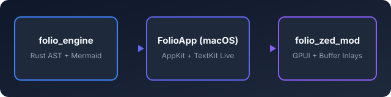
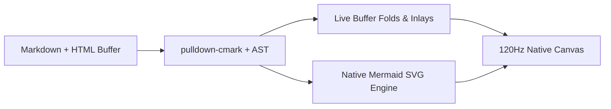
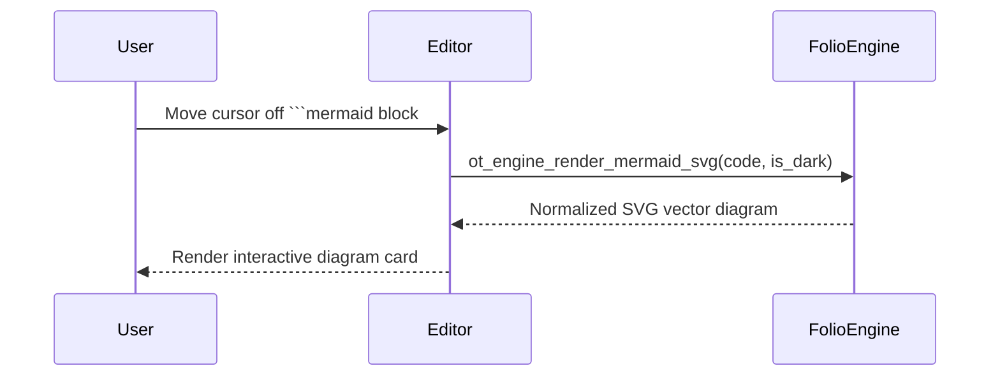
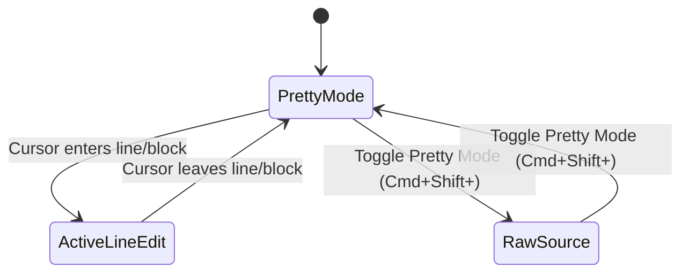
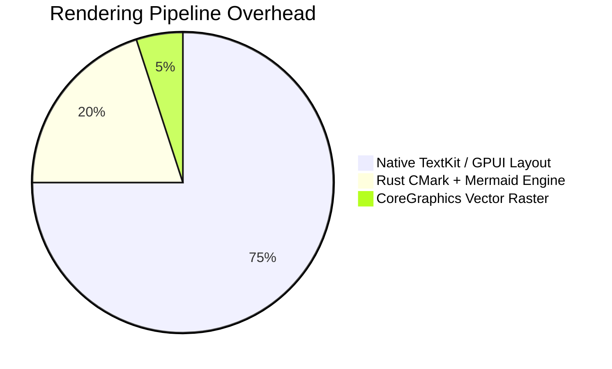
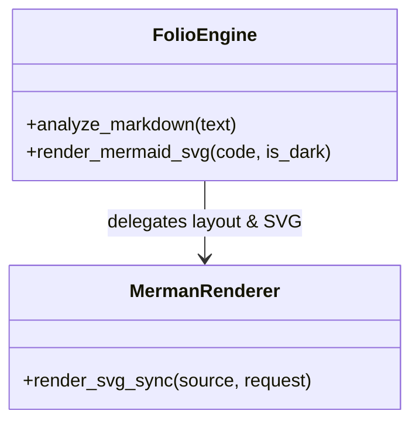
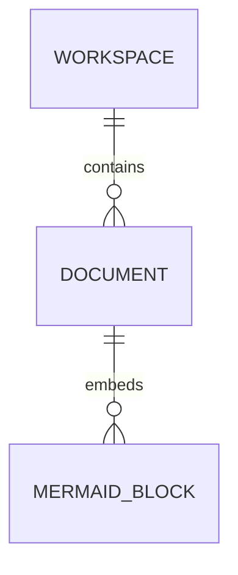

# Folio Rich Media & Pretty Mode Showcase

Welcome to the **Rich Media & Pretty Mode** test document! Move your cursor onto any image, video, Mermaid diagram, SVG block, or inline HTML tag to reveal its raw source, or toggle **Pretty Mode** at any time with <kbd>Cmd</kbd> + <kbd>Shift</kbd> + <kbd>\\</kbd>.

---

## 1. Images & Video Cards

### Standard Markdown Image (Relative Workspace Path)


### HTML `` Tag with Explicit Dimensions


### Video Embed (`<video>` & Markdown Video Links)
<video src="assets/demo_walkthrough.mp4" title="Folio 120Hz Live WYSIWYG Walkthrough" width="520" height="240"></video>

---

## 2. Inline HTML Markup

When **Pretty Mode** is active, inline HTML tags fold cleanly on inactive lines:
- **Keyboard shortcuts**: Press <kbd>Cmd+P</kbd> for Quick Open, <kbd>Cmd+Shift+F</kbd> for Global Search, or <kbd>F8</kbd> for Focus Mode.
- **Highlighting & Underline**: Combine <mark>highlighted callouts</mark> with <u>underlined key terms</u> and <ins>inserted text</ins>.
- **Subscripts & Superscripts**: Chemical formulas like H<sub>2</sub>O and CO<sub>2</sub> alongside mathematical notation like x<sup>2</sup> + y<sup>2</sup> = r<sup>2</sup>.
- **Strikethrough & Emphasis**: Compare <del>legacy WebView rendering</del> against <strong>native CoreGraphics & GPUI layout</strong>.

---

## 3. Native Mermaid Diagrams (` ```mermaid `)

### Flowchart (`flowchart LR`)


### Sequence Diagram (`sequenceDiagram`)


### State Diagram (`stateDiagram-v2`)


### Pie Chart (`pie`)


### Class Diagram (`classDiagram`)


### Entity-Relationship Diagram (`erDiagram`)


---

## 4. Inline SVG Vector Blocks (` ```svg `)

```svg
<svg viewBox="0 0 520 110" width="520" height="110" xmlns="http://www.w3.org/2000/svg">
  <rect x="8" y="8" width="504" height="94" rx="12" fill="#eff6ff" stroke="#3b82f6" stroke-width="2"/>
  <circle cx="58" cy="55" r="26" fill="#2563eb"/>
  <path d="M 48 55 L 55 62 L 70 46" stroke="#ffffff" stroke-width="4" fill="none" stroke-linecap="round" stroke-linejoin="round"/>
  <text x="104" y="48" fill="#1e3a8a" font-family="-apple-system, sans-serif" font-size="16" font-weight="bold">Inline SVG Block Rendering</text>
  <text x="104" y="72" fill="#475569" font-family="-apple-system, sans-serif" font-size="13">Click anywhere on this card to inspect and edit the raw &lt;svg&gt; markup.</text>
</svg>
```
